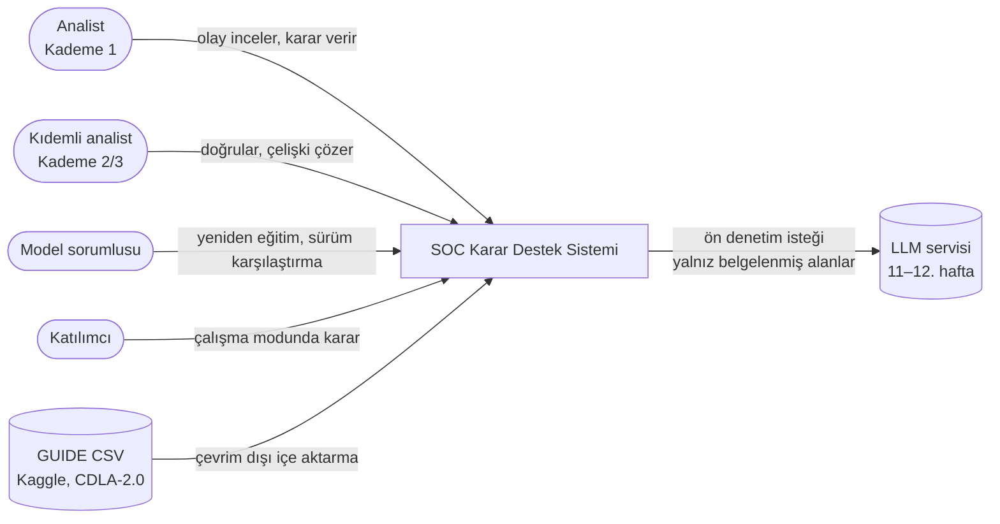
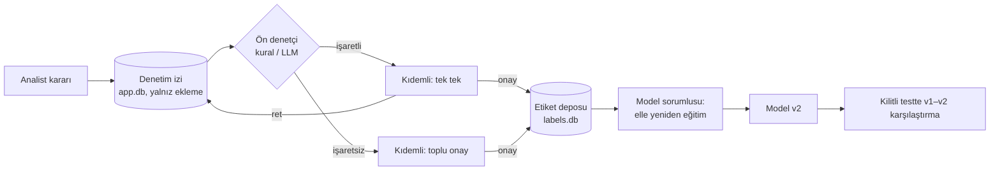
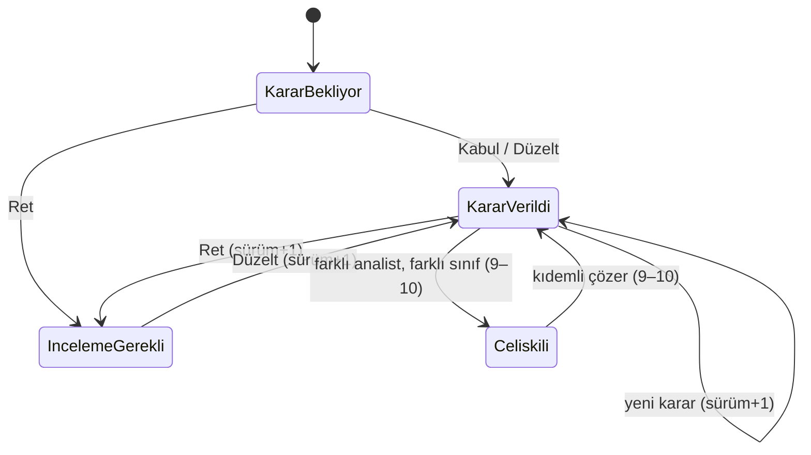
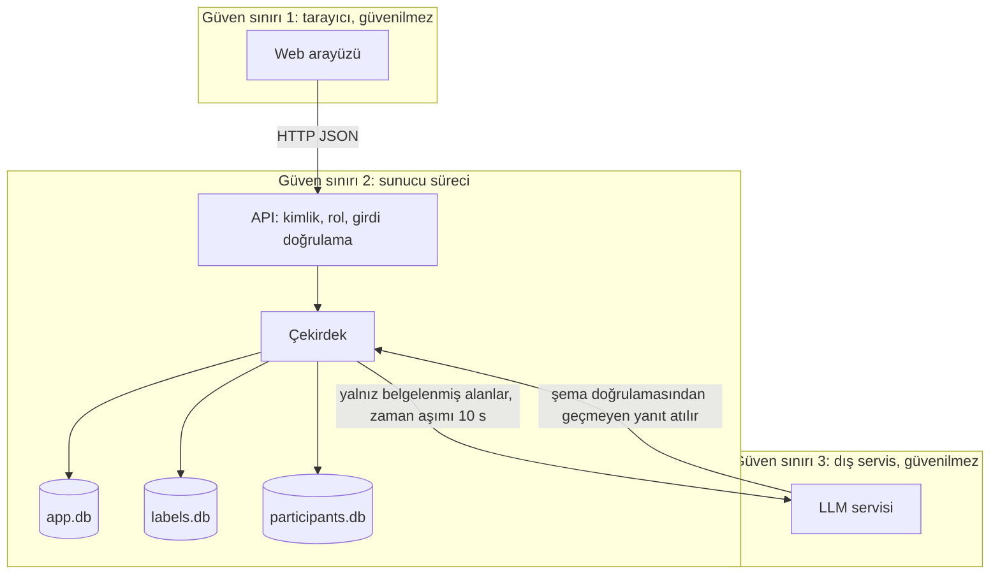

# Mimari: Açıklanabilir SOC Karar Destek Arayüzü

- **Güncelleme:** 2026-11-02
- **İlgili dokümanlar:** `docs/srs.md`, `docs/data-design.md`, `docs/decisions/0001`–`0005`, `docs/experiments/2026-11-02-temel-model-ve-as1.md`

Bu belge yol haritası Adım 2.1 (bileşen ve veri akışı; roller, güven sınırları, hata durumları) ve Adım 2.2'nin (ekran taslakları, §11) çıktısıdır. **Sahip** sütunundaki A ve B, görev paketlerini gösterir: A Mehmet Emin Duran'a (veri, model, depolar), B Ali İhsan Dağaşan'a (API, arayüz, ön denetçi) aittir.

## 1. Bağlam (C4 seviye 1)



Sistem hiçbir dış sisteme eylem göndermez (FR-25). Tek giden bağlantı LLM ön denetçisidir. O da yoksa sistem kural tabanlı ön denetçiyle çalışmaya devam eder (FR-18).

## 2. Konteynerler (C4 seviye 2)

| Konteyner | Teknoloji | Sorumluluk | İletişim | Sahip |
|---|---|---|---|---|
| Web arayüzü | HTML/CSS/vanilla JS, statik dosya (ADR-0001) | Kuyruk, olay ekranı, karar formu; ileride doğrulama, model ve çalışma ekranları | HTTP/JSON → API | B |
| API sunucusu | Python 3.11, FastAPI, uvicorn | REST uç noktaları, kimlik ve rol yetkisi, giriş doğrulama | Çekirdek paketi doğrudan çağırır | B |
| Çekirdek paket `socxai` | Python 3.11 | Alan mantığı: veri hattı, model, açıklama, karar sürümleme, depolar | Fonksiyon çağrısı; SQLite; Parquet | A + B (bileşen bazında, §3) |
| Uygulama deposu `app.db` | SQLite (WAL) | Kullanıcılar, olay kartları, öneriler, denetim izi (yalnız eklenebilir) | `sqlite3` | A |
| Etiket deposu `labels.db` | SQLite | Yalnız kıdemli onaylı eğitim etiketleri | `sqlite3` | A |
| Katılımcı deposu `participants.db` | SQLite | Çalışma modu kayıtları, anonim kod | `sqlite3` | A (şema), B (çalışma modu) |
| İşlenmiş veri | Parquet, DuckDB ile üretilir | Olay tablosu, dilimler, özellik matrisleri | Dosya | A |
| Model kayıt alanı | `artifacts/models/<sürüm>/` (joblib + JSON) | Eğitilmiş modeller, ölçütler, ayarlar | Dosya | A |
| Betikler ve simülasyon | Python CLI (`scripts/`) | Veri hattı, eğitim, demo tohumlama, AS1 | Çekirdek paketi doğrudan çağırır | A |

## 3. Bileşenler (C4 seviye 3, çekirdek paket)

| Bileşen (modül) | Sorumluluk | Sunduğu arayüz | Kullandığı | Sahip | Hafta |
|---|---|---|---|---|---|
| `socxai.config` | Yollar, sınıflar, kategoriler, bölme oranları, eşik | sabitler, `Settings` | — | A | 5 |
| `socxai.data.guide` | GUIDE → olay tablosu, kapsam süzgeci, 4 dilimli bölme, veri sürümü (FR-26) | `build_incidents(raw_dir, out_dir) -> DataVersion` | DuckDB | A | 5 |
| `socxai.data.features` | Okunur alanlardan olay özellikleri; sözlük yalnız T1'den (ADR-0005) | `fit_vocab(t1)`, `build_features(slice, vocab) -> DataFrame` | DuckDB | A | 5 |
| `socxai.data.cards` | Olay kartı ve tutarlı takma adlar (FR-02) | `build_card(incident_key) -> dict` | DuckDB, `mitre` | A | 5 |
| `socxai.data.mitre` | Teknik kodu → ad | `technique_name(code) -> str \| None` | yerel CSV | A | 5 |
| `socxai.model.baseline` | Lojistik regresyon eğitimi ve değerlendirmesi (FR-27) | `train(X, y, seed) -> Model`, `evaluate(model, X, y) -> Metrics` | scikit-learn | A | 5 |
| `socxai.model.explain` | Doğrusal SHAP; ileride LightGBM `pred_contrib` (FR-05) | `explain(model, x) -> Explanation` | numpy | A | 5 |
| `socxai.model.registry` | Model sürümlerinin kaydı ve yüklenmesi | `save(model, meta) -> version`, `load(version)` | joblib | A | 5 |
| `socxai.store.db` | Bağlantılar, şema kurulumu, göç (`PRAGMA user_version`) | `connect(path)`, `migrate(conn)` | sqlite3 | A | 5 |
| `socxai.store.suggestions` | Bir model sürümünün T2 olayları için öneri ve açıklamasını toplu üretip kaydeder | `score_pool(version)` | model, db | A | 5 |
| `socxai.decisions` | Karar doğrulama, sürümleme, tekilleştirme, çelişki (FR-06–12) | `record_decision(conn, cmd) -> DecisionEvent`, `history(conn, key)` | db | B | 5 (çelişki 9–10) |
| `socxai.auth` | Kullanıcı ve rol, izin matrisi (FR-23, FR-24) | `require(role_or_perm)` | db | B | 5 (demo), 7–8 |
| `socxai.api` | FastAPI uygulaması, uç noktalar, statik dosyalar | §6 | `decisions`, `auth`, db | B | 5 |
| `socxai.review` | Doğrulama kuyruğu, toplu onay, etiket deposuna yazma (FR-13–15) | `approve(...)`, `bulk_approve(...)` | db, labels.db | B (akış), A (etiket deposu) | 9–10 |
| `socxai.precheck` | Kural ve LLM ön denetçisi, geri düşme (FR-16–18) | `check(record) -> Flag` | — / LLM istemcisi | B | 9–12 |
| `socxai.retrain` | Yeniden eğitim ve sürüm karşılaştırması (FR-19–21) | `retrain(...)`, `compare(v1, v2)` | labels.db, model | A | 9–12 |
| `socxai.sim` | AS1 simülasyonu (FR-29) | `run_grid(config) -> DataFrame` | `decisions`, `precheck`, `retrain` | A | 13–14 |
| `socxai.study` | Çalışma modu (FR-31–34) | — | participants.db | B | 15–16 |

**Bağımlılık kuralı:** `api` → (`decisions`, `auth`, `review`, ...) → `store` / `model` / `data`. Çekirdek modüller `api`'yi içe aktarmaz. `sim` HTTP kullanmaz.

## 4. Önemli akışlar

### 4.1 Demo akışı: öneri + SHAP → karar → önceki karar görünür (FR-02–10)

```mermaid
sequenceDiagram
  actor A as Analist
  participant W as Web arayüzü
  participant API as API (FastAPI)
  participant D as decisions
  participant DB as app.db
  A->>W: Kuyruktan olay seçer
  W->>API: GET /api/incidents/{key} (X-User)
  API->>DB: kart + etkin model önerisi + açıklama + karar geçmişi
  API-->>W: 200 {card, suggestion, explanation, history, opened_at}
  A->>W: Düzelt: sınıf + gerekçe
  W->>API: POST /api/incidents/{key}/decisions
  API->>API: rol yetkisi (analist mi?)
  API->>D: record_decision(cmd)
  D->>DB: BEGIN IMMEDIATE; etkin karar oku; doğrula; sürüm = son+1; INSERT decision_events; COMMIT
  D-->>API: DecisionEvent (sürüm 2)
  API-->>W: 201 {event}
  W->>API: GET /api/incidents/{key}
  API-->>W: geçmişte sürüm 1 ve 2 görünür
```

### 4.2 Geri bildirim → etiket deposu → yeniden eğitim (9–12. hafta)



Doğrulanmamış hiçbir kayıt `labels.db`'ye giremez. `labels.db`'ye yazan tek kod yolu `review.approve` ve `review.bulk_approve`'dur ve yalnız kıdemli rolüyle çağrılabilir (FR-15, FR-22).

## 5. Durum modeli (olay)



- Durum saklanmaz, denetim izinden türetilir (`docs/data-design.md`, `v_effective_decision`).
- Önerideki "inceleme gerekli" işareti (FR-04) olay durumu değildir. Önerinin bir niteliğidir.
- Aynı analist kararını değiştirirse çelişki doğmaz; yeni sürüm oluşur.
- Etkin kararla aynı sonuç tekrar gelirse yeni sürüm açılmaz; kayıt denetim izine `is_duplicate=1` ile girer (FR-11).

## 6. Arayüz sözleşmeleri (REST API, v1)

Bütün yanıtlar JSON. Hata gövdesi `{"error": "<kod>", "message": "<Türkçe açıklama>"}`. Zamanlar ISO 8601 UTC. Sınıf kodları `TP`, `BP`, `FP`; arayüz etiketleri sırasıyla "Gerçek tehdit", "Zararsız-beklenen", "Yanlış alarm".

**Kimlik (demo):** İstek başlığında `X-User: <kullanıcı adı>` gönderilir. Sunucu kullanıcıyı `users` tablosunda bulur ve rolü oradan okur; istemcinin rol beyanına güvenilmez. 7–8. haftada bu yerini yerel hesap ve oturum çerezine bırakır (FR-24). Demo kimliği yalnız yerel makinede, eğitim amacıyla kullanılır.

| Yöntem ve yol | Rol | Girdi | Başarılı | Hatalar | FR | Hafta |
|---|---|---|---|---|---|---|
| `GET /api/users` | herkes (demo) | — | `[{username, display_name, role}]` | — | FR-24 (demo) | 5 |
| `GET /api/incidents?status=` | analist, kıdemli, model sorumlusu | `status` ∈ {pending, decided, review, all} | `[{key, category, n_alerts, status, suggestion:{class, confidence, needs_review}}]` | 401 | FR-01 | 5 (basit), 7–8 |
| `GET /api/incidents/{key}` | analist, kıdemli, model sorumlusu | — | `{card, suggestion, explanation, effective, history[], opened_at}` | 401, 404 | FR-02–05, FR-10 | 5 |
| `POST /api/incidents/{key}/decisions` | yalnız analist | `{type: accept\|correct\|reject, decided_class?, reason?, opened_at}` | 201 `{event}` | 400 `reason_required`, 400 `class_required`, 400 `same_as_suggestion`, 401, 403 `forbidden`, 404, 409 `no_suggestion` | FR-06–11 | 5 |
| `GET /api/incidents/{key}/history` | herkes (rol sahibi) | — | `[DecisionEvent]` | 401, 404 | FR-10 | 5 |
| `GET /api/review/queue` | kıdemli | — | işaretli ve işaretsiz listeler | 401, 403 | FR-13 | 9–10 |
| `POST /api/review/{event_id}` | kıdemli | `{approve: bool, reason?}` | 201 | 401, 403, 409 | FR-13, FR-15 | 9–10 |
| `POST /api/review/bulk-approve` | kıdemli | `{event_ids[]}` (yalnız işaretsizler) | 201 `{approved: n}` | 400 (işaretli kayıt içeriyor), 403 | FR-13 | 9–10 |
| `POST /api/conflicts/{key}/resolve` | kıdemli | `{decided_class, reason}` | 201 | 400, 403 | FR-14 | 9–10 |
| `POST /api/models/retrain` | model sorumlusu | `{base_version}` | 202 `{version}` | 403 | FR-19 | 9–10 |
| `GET /api/models/compare?a=&b=` | model sorumlusu | — | ölçüt tablosu | 403, 404 | FR-20 | 9–10 |
| `POST /api/models/{version}/activate` | model sorumlusu | — | 200 | 403, 404 | FR-21 | 11–12 |

**`DecisionEvent`:** `{id, incident_key, version|null, is_duplicate, decision_type, decided_class|null, reason, suggested_class, suggested_confidence, model_version, data_version, actor, actor_role, opened_at, decided_at}`.

**`explanation`:** `{model_version, target_class, base_value, output, contributions: [{feature, field, raw_value, contribution}]}`. Liste `|contribution|` değerine göre azalan sıradadır. `base_value + Σ contribution = output` (logit ölçeği), tolerans 1e-6 (AC-05).

**Doğrulama kuralları (`decisions.record_decision`):**
1. Olayın etkin model sürümü için önerisi yoksa 409.
2. `accept`: `decided_class` boş bırakılır, önerilen sınıf olarak yazılır.
3. `correct`: `decided_class` zorunlu ve önerilen sınıftan farklı; `reason` kırpıldıktan sonra boş değil.
4. `reject`: `reason` zorunlu; `decided_class` boş; sonuç "inceleme gerekli".
5. Sonuç (sınıf ya da "inceleme gerekli") etkin kararınkiyle aynıysa yeni sürüm açılmaz: `version=null`, `is_duplicate=1`.
6. Gerekçe en çok 2.000 karakter.

## 7. Roller ve izin matrisi (FR-23, K4)

| İşlem | Analist | Kıdemli | Model sorumlusu |
|---|---|---|---|
| Kuyruk ve olay görüntüleme | ✓ | ✓ | ✓ (salt okuma) |
| Karar verme (Kabul / Düzelt / Ret) | ✓ | — | — |
| Karar geçmişini ve denetim izini okuma | ✓ | ✓ | ✓ |
| Doğrulama (tekil onay/ret, toplu onay) | — | ✓ | — |
| Çelişki çözme | — | ✓ | — |
| Etiket deposuna yazma | — | yalnız onay yoluyla | — |
| Yeniden eğitim, sürüm karşılaştırma, etkin sürüm seçimi | — | — | ✓ |
| Etiket ya da karar değiştirme | — | — | — (görev ayrılığı) |

Yetkisiz istek 403 döner ve `system_events` tablosuna `unauthorized` olarak yazılır (NFR-05).

## 8. Güven sınırları



- **Sınır 1 → 2:** Arayüzden gelen hiçbir alana güvenilmez. Rol sunucuda okunur, gerekçe uzunluğu ve sınıf kodu doğrulanır, SQL parametreli yazılır. Arayüzdeki gerekçe ve kart metni `textContent` ile basılır (XSS önlemi).
- **Sınır 2 → 3 (11–12. hafta):** LLM'e yalnız NFR-08'deki alan listesi gider. Yanıt bir JSON şemasına uymalıdır; uymazsa kural ön denetçisine düşülür (FR-18, NFR-09). Olay alanları ve gerekçe, talimat metninden ayrı bir veri bloğu olarak verilir.
- **Depolar arası:** Eğitim kodu `app.db`'yi okumaz, yalnız `labels.db`'yi okur. `participants.db`'de kullanıcı kimliği yoktur; `app.db`'de katılımcı kodu yoktur (K5).

## 9. Hata durumları

| Durum | Davranış | Kullanıcıya | FR/NFR |
|---|---|---|---|
| Gerekçesiz düzeltme ya da ret | 400 `reason_required`, kayıt yok | "Gerekçe zorunludur." | FR-07, FR-08 |
| Önerilen sınıfa "düzeltme" | 400 `same_as_suggestion` | "Bu bir kabul işlemidir." | FR-07 |
| Yetkisiz rol | 403, `system_events` kaydı | "Bu işlem için yetkiniz yok." | FR-23, NFR-05 |
| Bilinmeyen olay ya da kullanıcı | 404 / 401 | açıklayıcı ileti | — |
| Etkin model için öneri yok | 409 `no_suggestion` | "Bu olay için öneri yok." | FR-03 |
| Aynı anda iki karar | `BEGIN IMMEDIATE` ile sıralanır; ikincisi doğru sürüm numarasını alır | — | FR-10 |
| Denetim izini değiştirme girişimi | SQLite tetikleyicisi `ABORT` | — | NFR-06 |
| Veritabanı dosyası yok ya da şema eski | Başlangıçta göç; olmazsa süreç açık hatayla durur | — | — |
| LLM yok, zaman aşımı ya da şema dışı yanıt | Kural ön denetçisine düşülür, kaydedilir | ön denetçi: "kural (geri düşme)" | FR-18, NFR-12 |
| GUIDE dosyası eksik ya da sütun değişmiş | Veri hattı hangi dosyanın ya da sütunun eksik olduğunu söyleyerek durur | — | FR-26 |
| Bellek yetersiz | DuckDB diske taşar; pandas'a yalnız olay düzeyi tablo alınır | — | NFR-03 |

## 10. Nitelik senaryoları

| NFR | Senaryo | Mimarideki karşılığı |
|---|---|---|
| NFR-01 | Analist bir olayı açar; p95 ≤ 2 s | Öneri ve açıklama, model sürümü kaydedilirken toplu üretilip `suggestions` tablosuna yazılır. İstek yalnız indeksli okuma yapar |
| NFR-02 | Karar kaydı p95 ≤ 500 ms | Tek INSERT, kısa işlem, WAL |
| NFR-03 | Veri hattı ≤ 6 GB | Toplama DuckDB'de yapılır; Python'a yalnız olay × özellik matrisi (float32) alınır |
| NFR-05 | Yetkisiz istek reddedilir | Her uç nokta `require(perm)` bağımlılığıyla korunur |
| NFR-06 | Denetim izi değiştirilemez | Tetikleyiciler; uygulamada UPDATE/DELETE kod yolu yok |
| NFR-13 | Tekrarlanabilirlik | Model meta verisi: veri sürümü, tohum, ayarlar, paket sürümleri |

## 11. Ekran taslakları (Adım 2.2)

Bugün demoda S1 ve S2 çalışır. S3–S5 ileriki haftalarda gelir. Bütün ekranlarda üst bilgi şeridinde "Sistem otomatik müdahale yapmaz." yazar (FR-25).

**S1: Olay kuyruğu (analist)**

```
+----------------------------------------------------------------------------+
| SOC Karar Destek | Kullanıcı: [analist1 v]  rol: Analist                    |
| Sistem otomatik müdahale yapmaz.                                           |
+----------------------------------------------------------------------------+
| Filtre: (•) Karar bekleyen  ( ) Karar verilen  ( ) İnceleme gerekli        |
+----------+--------------------+--------+----------------------+-----------+
| Olay     | Kategori           | Uyarı  | Model önerisi        | Durum     |
+----------+--------------------+--------+----------------------+-----------+
| 1234-56  | InitialAccess      |   3    | Yanlış alarm  %91    | Bekliyor  |
| 88-1023  | Exfiltration       |   1    | Zararsız      %48 ⚠  | Bekliyor  |
|   ...    |                    |        | (⚠ = inceleme gerekli)|           |
+----------+--------------------+--------+----------------------+-----------+
```

**S2: Olay ekranı (analist; demonun ana ekranı)**

```
+----------------------------------------------------------------------------+
| ← Kuyruk   Olay 1234-56 · InitialAccess · 3 uyarı · 14 kanıt               |
+-------------------------------------+--------------------------------------+
| KANIT (vaka kartı)                  | MODEL ÖNERİSİ (v1, taban model)      |
| MITRE: T1078 Valid Accounts,        |  Yanlış alarm   güven %91            |
|        T1566.002 Spearphishing Link |  [Gerçek %4 | Zararsız %5 | YA %91]  |
| Varlıklar:                          |  ⚠ yoksa: "inceleme gerekli" etiketi |
|  Kullanıcı-17  User      Impacted   |--------------------------------------|
|  Cihaz-3       Machine   Related    | NEDEN? (SHAP katkıları, ham alan)    |
|  Posta-5       MailMessage Related  |  LastVerdict=NoThreatsFound (x2) +1.2|
| Şüphe: Suspicious (1)               |  EntityType=MailMessage (x5)   +0.8  |
| Hüküm: NoThreatsFound (2)           |  Category=InitialAccess        -0.3  |
| Uyarılar: #1 #2 #3 (kategori, zaman)|  ... taban 0.2 + toplam = 2.4        |
+-------------------------------------+--------------------------------------+
| KARARINIZ                                                                  |
|  [ Kabul et ]  [ Düzelt ▾ Gerçek tehdit | Zararsız-beklenen | Yanlış alarm ]|
|  [ Reddet (inceleme gerekli) ]                                             |
|  Gerekçe: [______________________________________________] (Düzelt/Ret'te zorunlu)|
|  [ Kaydet ]                                                                |
+----------------------------------------------------------------------------+
| KARAR GEÇMİŞİ                                                              |
|  v2  2026-11-03 10:42  Analist (analist1)  Düzelt → Gerçek tehdit          |
|      Gerekçe: "Kullanıcı-17 iki farklı ülkeden oturum açmış ..."           |
|  v1  2026-11-03 10:40  Analist (analist1)  Kabul → Yanlış alarm            |
+----------------------------------------------------------------------------+
```

**S3: Doğrulama kuyruğu (kıdemli, 9–10. hafta)**

```
+----------------------------------------------------------------------------+
| İşaretli (tek tek)                     | İşaretsiz (toplu)                 |
| ⚑ 1234-56 Düzelt YA→GT  neden: güven   | 40 kayıt  [ Hepsini onayla ]      |
|   %95 ile çelişiyor, gerekçe kısa      |                                   |
|   [Onayla] [Reddet] [Olayı aç]         |                                   |
| ⚡ 77-12 ÇELİŞKİLİ: analist1 GT,         |                                   |
|   analist2 YA  [Çöz: sınıf + gerekçe]  |                                   |
+----------------------------------------------------------------------------+
```

**S4: Model sürümleri (model sorumlusu, 9–12. hafta):** sürüm listesi (etkin işaretli), "Yeniden eğit" düğmesi (onaylı etiket sayısı gösterilir), iki sürüm seçilince kilitli testte macro-F1, doğruluk, sınıf bazlı P/R/F1 ve karışıklık matrisi yan yana.

**S5: Çalışma modu (katılımcı, 15–16. hafta):** katılımcı kodu → alıştırma (sentetik kartlar, TP/BP/FP tanımları) → üç blok (koşul sırası dengeli). Her blokta kart; koşula göre öneri ve açıklama paneli gizli. Karar ve süre kaydedilir. Blok sonunda SUS, Raw NASA-TLX ve AI koşullarında Jian ölçeği; en sonda "anlaşılmayan noktalar" sorusu.

## 12. Dağıtım ve çalışma ortamı

- **Ortam:** Windows 11, Python 3.11 sanal ortamı `.venv`, `requirements.txt` ile sabitlenmiş sürümler (ADR-0003).
- **Çalıştırma:** `python -m socxai.api` (uvicorn, `127.0.0.1:8000`). Yalnız yerel ağ arayüzüne bağlanır.
- **Yapılandırma:** `socxai.config` varsayılanları, ortam değişkenleriyle ezilir (`SOCXAI_DATA_DIR` vb.). Gizli bilgi (LLM anahtarı, 11–12. hafta) yalnız ortam değişkeninde ya da git'e girmeyen `.env` dosyasında tutulur (NFR-07).
- **Git dışı:** `data/`, `artifacts/`, `*.db`, `.venv/`, `.env`.

## 13. Kararlar

| ADR | Karar |
|---|---|
| 0001 | Python çekirdek + FastAPI REST + düz HTML/CSS/JS |
| 0002 | SQLite (3 dosya) + Parquet/DuckDB |
| 0003 | Lojistik regresyon + LightGBM; SHAP kapalı form ve yerleşik; Python 3.11 venv |
| 0004 | Dört zaman dilimli olay bazlı bölme 50/20/15/15 |
| 0005 | Taban model ve demo yalnız okunur alanlarla; kimlik alanları ablasyonla |

## 14. Riskler ve teknik borç

- Demo kimliği (`X-User`) güvenli değildir; 7–8. haftada FR-24 ile kapanır. Bu süre içinde sunucu yalnız `127.0.0.1`'e bağlanır.
- Vanilla JS ekran sayısı arttıkça dağılabilir (ADR-0001).
- `labels.db` ↔ `app.db` bağı uygulama düzeyinde denetleniyor; bunun testi 9–10. haftada yazılacak.
- Öneriler toplu üretiliyor. Etkin sürüm değiştiğinde (FR-21) yeni sürümün havuzu skorlanmadan sürüm etkinleştirilmemeli.
