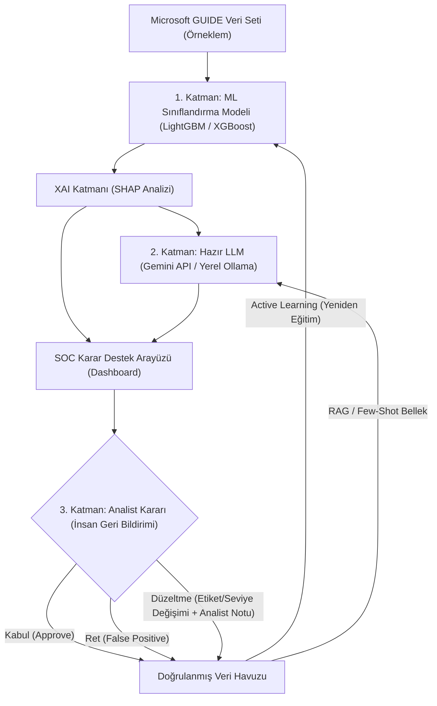

# İnsan-Yapay Zeka İşbirliğine Dayalı Açıklanabilir SOC Karar Destek Arayüzü
**Proje Ön Analiz, Mimari Tartışma ve Yol Haritası Raporu**

---

## 1. Proje Konusunun ve Odak Noktasının Analizi

* **Ana Konu:** İnsan-Yapay Zeka İşbirliğine Dayalı Açıklanabilir SOC (Siber Güvenlik Operasyon Merkezi) Destek Arayüzü
* **Grup Odak Noktası:** SOC analistinin model önerisini **kabul, ret veya düzeltme** yoluyla değerlendirdiği karar destek arayüzü (**İnsan Geri Bildirimi / Human-in-the-Loop - HITL**).

### Temel Kavramların Literatürdeki Karşılıkları
1. **İnsan-Yapay Zeka İşbirliği (Human-AI Collaboration):** Siber güvenlikte tam otomasyon (YZ'nin kendi başına IP engellemesi veya sunucu kapatması) yüksek risk taşır. Tek başına insan analist ise milyonlarca logu inceleyemez (**Alert Fatigue - Alarm Yorgunluğu**). İşbirliği; yapay zekanın alarmları önceliklendirip gerekçesiyle öneri sunması, **son kararın (Kabul/Ret/Düzelt) insan analist tarafından verilmesi** ve bu kararın modeli beslemesi döngüsüdür.
2. **Açıklanabilir Yapay Zeka (XAI - Explainable AI):** Modelin bir alarma neden "Saldırı (True Positive)" veya "Yanlış Alarm (False Positive)" dediğini matematiksel ve görsel olarak (**SHAP**, **LIME** vb. yöntemlerle hangi veri sütununun kararı yüzde kaç etkilediğini) şeffaf biçimde göstermesidir.
3. **İnsan Geri Bildirimi (Active Learning / Feedback Loop):** Analistin arayüz üzerinden verdiği Kabul, Ret veya Düzeltme kararlarının kaydedilerek yapay zeka modelinin zamanla daha az hata yapacak şekilde güncellenmesidir (yeniden eğitim, eşik değeri güncelleme veya bellek güncelleme).

---

## 2. Kritik Soru: "Kesinlikle LLM Kullanmak Zorunda mıyız?"

### Kısa Cevap:
**Hayır, sıfırdan bir LLM geliştirmek zaten söz konusu değildir; hatta tek başına hazır bir LLM kullanmak da zorunlu değildir.** Ancak klasik Makine Öğrenmesi + XAI (SHAP) yapısının üzerine **hazır bir LLM (API veya yerel model) entegre edilerek "Hibrit Mimari" kurulması** projeyi hem bilimsel hem de görsel açıdan en üst seviyeye taşır.

### Neden Sadece LLM Kullanmak Risklidir?
1. **Veri Seti Yapısı (Tablosal Veri):** Kullanılması planlanan **Microsoft GUIDE** gibi SOC veri setleri milyonlarca satır ve onlarca sayısal/kategorik sütundan (`DetectorId`, `Category`, `EntityType`, `OSFamily` vb.) oluşur. LLM'ler devasa tablosal veriler üzerinde istatistiksel anomali/sınıflandırma eğitimi yapmak için uygun değildir.
2. **Bilimsel XAI Beklentisi:** Akademik jüriler "Açıklanabilir YZ" dendiğinde modelin iç ağırlıklarını ve özellik önem düzeylerini (Feature Importance / SHAP değerleri) görmek ister. LLM'in ürettiği sözel metinler tek başına matematiksel XAI yerine geçmez (halüsinasyon riski vardır).
3. **Geri Bildirimin Ölçülebilirliği:** Analist "Ret" veya "Düzeltme" yaptığında koskoca bir LLM'i anında yeniden eğitemezsiniz. Oysa klasik bir ML modelini (XGBoost, LightGBM, Random Forest) analistin düzelttiği verilerle yeniden eğitip *"İnsan geri bildirimi sonrasında modelin F1 skoru %82'den %90'a çıktı, yanlış alarm oranı %15'ten %5'e düştü"* şeklinde somut başarı grafikleri sunabilirsiniz.

---

## 3. Yaklaşımların Karşılaştırması

| Kriter | Yaklaşım 1: Sadece Klasik ML + XAI (SHAP) | Yaklaşım 2: Sadece LLM | Yaklaşım 3: HİBRİT MİMARİ (ML + SHAP + Hazır LLM) *(Önerilen)* |
| :--- | :--- | :--- | :--- |
| **Microsoft Veri Setine Uyum** | **Tam Uyumlu** (Tablo verisiyle doğrudan eğitilir). | **Düşük** (Tablo verisini doğrudan işleyemez). | **Tam Uyumlu** (ML tabloyu işler, LLM seçilen alarmı yorumlar). |
| **Açıklanabilirlik (XAI)** | Matematiksel ve grafiksel (SHAP grafikleri). | Sadece sözel özet. | **Hem Grafiksel (SHAP) Hem Sözel (LLM Özeti).** |
| **İnsan Geri Bildirimi (Kabul/Ret/Düzelt)** | Etiket düzeltme ve modeli yeniden eğitme (Active Learning). | Sadece metin tabanlı hafıza (RAG). | **Hem Modeli Yeniden Eğitir Hem Analistin Yazılı Notlarını Anlamlandırır.** |
| **Jüri / Akademik Etki** | Sağlam ve kurallara uygun. | Eksik bulunma riski yüksek. | **En Yüksek Etki** (Hem bilimsel metrik sunar hem modern LLM yeteneklerini barındırır). |

---

## 4. Önerilen "Kazan-Kazan" Çözümü: Hibrit Sistem Mimarisi

Grup içindeki tüm fikirleri birleştiren ve projenin "İnsan Geri Bildirimi" odağını tam on ikiden vuran mimari şu 3 katmandan oluşur:

### Adım Adım Çalışma Senaryosu:
1. **ML ve XAI Katmanı (Tahmin ve Matematiksel Açıklama):**
   * Arka planda çalışan `XGBoost` veya `LightGBM` modeli gelen alarmı inceler: *"Tahmin: %87 True Positive (Gerçek Saldırı) - Kategori: InitialAccess"*.
   * `SHAP` kütüphanesi bu kararın matematiksel nedenlerini çıkarır: *"Kararı etkileyen en önemli 3 faktör: SuspicionLevel (+0.42), DetectorId (+0.31), CountryCode (+0.14)"*.
2. **Hazır LLM Katmanı (Bilişsel Destek ve Öneri):**
   * Sıfırdan LLM geliştirilmez; hazır bir API (**Google Gemini API**, **OpenAI API**) veya yerel bir açık kaynak model (**Ollama + Llama-3 / Mistral**) bağlanır.
   * LLM, SHAP'tan gelen teknik çıktıyı ve geçmiş analist notlarını okuyarak analiste anlaşılır bir öneri sunar: *"Bu alarm yüksek şüpheli bir dış IP'den kaynaklanıyor. Geçmişte benzer alarmlar gerçek saldırı çıktı. Önerilen Aksiyon: Kullanıcı oturumunu sonlandır ve olayı onayla."*
3. **İnsan Geri Bildirimi Katmanı (Sizin Grubunuzun Ana Odağı):**
   * Analist arayüzde hem **SHAP grafiğini** hem de **LLM önerisini** görür ve şu 3 aksiyondan birini alır:
     * **Kabul (Approve):** Öneriyi onaylar.
     * **Ret (Reject):** *"Hayır, bu bir False Positive (Yanlış Alarm)"* diyerek reddeder.
     * **Düzelt (Modify/Correct):** Alarmın ciddiyet seviyesini (Severity), saldırı kategorisini veya alınacak aksiyonu değiştirir ve serbest metin kutusuna kısa bir gerekçe yazar (Örn: *"Bu IP şirket içi sızma testi ekibine ait"*).
   * **Geri Bildirimin Sisteme Etkisi:**
     * Analistin düzelttiği etiketler **Geri Bildirim Veritabanına** kaydedilir. Arayüzdeki **"Modeli Geri Bildirimlerle Güncelle (Retrain)"** butonuna basıldığında ML modeli bu düzeltmelerle güncellenir ve hata oranının düştüğü ekranda canlı olarak gösterilir.
     * Analistin yazdığı metinsel notlar ise LLM'in hafızasına (RAG / Few-Shot) kaydedilir; bir sonraki benzer alarmda LLM analistin bu uyarısını dikkate alarak yeni öneri üretir.

---

## 5. Veri Seti Hakkında Notlar: Microsoft GUIDE

* **Veri Seti:** *Microsoft GUIDE: Guided Response to Cybersecurity Incidents* (Kaggle üzerinden erişilebilir).
* **Neden Çok Uygun?** İçerisinde gerçek SOC alarmları ve en önemlisi Microsoft analistlerinin bu alarmlara verdiği gerçek kararlar (`Grade`: *TruePositive*, *BenignPositive*, *FalsePositive*) yer alır.
* **Nasıl Kullanılmalı?** Veri setinin tamamı (~13 milyon satır) çok büyüktür. Bilgisayarları yormamak ve hızlı prototip geliştirmek için veri setinden dengeli bir şekilde **10.000 ila 50.000 satırlık bir alt küme (sample)** çekilerek çalışılmalıdır.

---

## 6. Grup Arkadaşlarıyla Paylaşılabilecek Özet Mesaj

> *"Arkadaşlar, konuyu detaylıca araştırdım. 'İnsan-Yapay Zeka İşbirliği' literatürde sadece chatbot (LLM) ile konuşmak anlamına gelmiyor; yapay zekanın tahmin üretmesi ve insanın Kabul/Ret/Düzelt butonlarıyla modele geri bildirim vererek onu eğitmesi (Human-in-the-Loop) anlamına geliyor.*
>
> *Elimizdeki Microsoft veri seti tablo verisi olduğu için önce arkada hızlı bir sınıflandırma modeli (XGBoost/LightGBM) ve gerçek 'Açıklanabilir YZ' şartını sağlamak için SHAP grafikleri kurmalıyız. Böylece analist geri bildirim verdikçe modelin doğruluğunun arttığını matematiksel grafiklerle hocaya kanıtlayabiliriz.*
>
> *Bunun üstüne arayüze hazır bir LLM API'si (Gemini/OpenAI veya yerel Llama-3) bağlayarak **Hibrit bir sistem** yapabiliriz. LLM hem SHAP grafiklerini analiste doğal dilde özetler ve aksiyon önerir, hem de analistin 'Ret/Düzeltme' yaparken yazdığı yazılı yorumları hafızasına alıp bir sonraki alarmda kullanır. Böylece sıfırdan LLM eğitme yüküne girmeden, hem bilimsel XAI ve geri bildirim metriklerini hem de modern LLM entegrasyonunu eksiksiz yapmış oluruz."*
