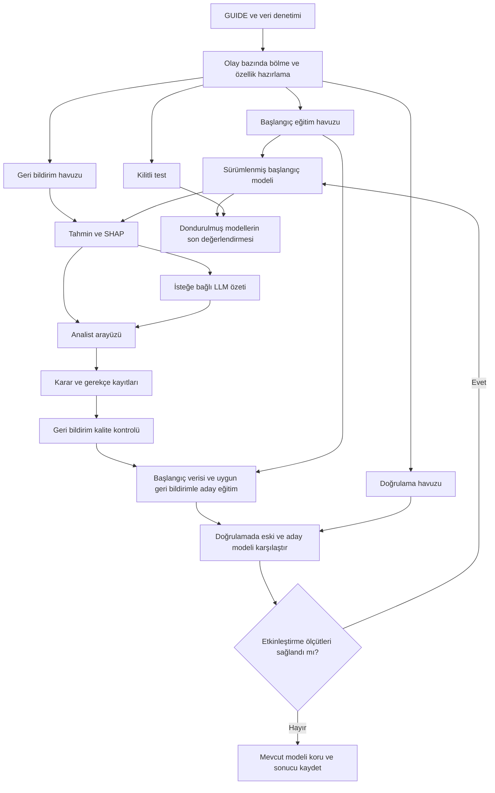

# İnsan–Yapay Zeka İşbirliğine Dayalı Açıklanabilir SOC Karar Destek Arayüzü

**Proje kapsamı, sistem mimarisi, deney tasarımı ve uygulama yol haritası**

**Belge durumu:** Uygulama öncesi proje planı  
**Revizyon tarihi:** 2 Kasım 2026  
**Ana odak:** SOC analistinin model önerisini incelemesi, kabul etmesi, reddetmesi veya düzeltmesi; açıklamaların ve geri bildirimin karar sürecine katkısının ölçülmesi.

> Bu belgede önerilen mimari ve deneyler henüz uygulanmış sonuçlar değildir. Performans artışı, zaman tasarrufu veya LLM katkısı garanti edilmez; bunlar deneylerle sınanacak hipotezlerdir. Takvim ve kapsam, ekip kapasitesi ile pilot veri incelemesi sonucunda kesinleştirilecektir.

## 1. Problem, amaç ve araştırma soruları

SOC (Siber Güvenlik Operasyon Merkezi) analistleri çok sayıda alarmın ilişkili kanıtlarını değerlendirerek olayın niteliğine karar verir. Projenin amacı, analistin bu değerlendirmeyi yaparken model tahminini ve tahminin dayanaklarını görebildiği, kendi kararını gerekçesiyle kaydedebildiği bir araştırma prototipi geliştirmektir.

**Temel araştırma sorusu:** Model açıklamaları ve analist geri bildirimi, olay sınıflandırma kararlarının doğruluğunu, süresini ve model hatalarının fark edilmesini nasıl etkiler?

| Soru | Karşılaştırma | Ölçülebilir çıktı |
| --- | --- | --- |
| SHAP açıklaması karar desteğini iyileştiriyor mu? | Yalnız tahmin / tahmin + SHAP | Karar doğruluğu, süre, yanlış model önerisini düzeltme oranı |
| LLM özeti ek fayda sağlıyor mu? | Tahmin + SHAP / tahmin + SHAP + LLM | Aynı ölçütler; ayrıca kanıta dayanmayan ifade oranı ve gecikme |
| İncelenmiş geri bildirim modelin genellemesini değiştiriyor mu? | Başlangıç modeli / geri bildirimle eğitilmiş aday | Macro-F1, sınıf bazlı precision ve recall |
| Belirsiz örnek seçimi etiketleme bütçesini daha verimli kullanıyor mu? | Eşit bütçeli rastgele seçim / belirsizlik temelli seçim | Etiket sayısına göre performans eğrisi; isteğe bağlı deney |

Çalışmanın katkısı, kullanılan bileşenlerin sayısıyla değil, tekrarlanabilir deney ve açıkça tanımlanmış insan–model etkileşimiyle değerlendirilecektir.

## 2. Kapsam ve teslim edilecek sürümler

### 2.1. Çekirdek sürüm — zorunlu

- GUIDE verisinden olay gruplarını koruyan bir alt küme hazırlama.
- Olay düzeyinde üç sınıflı tahmin: `TruePositive`, `BenignPositive`, `FalsePositive`.
- Model çıktısı ve seçilen sınıfa ait yerel SHAP açıklaması.
- Analistin nihai etiketi, öneriye yanıtı, gerekçesi ve inceleme durumunun ayrı kaydı.
- Karar geçmişi ve model sürümü izlenebilirliği.
- İncelenmiş geri bildirimlerle toplu yeniden eğitim ve aday model karşılaştırması.
- Model değerlendirmesi ve pilot arayüz çalışması.

### 2.2. İkinci sürüm — çekirdek tamamlandıktan sonra

- Sağlanan kanıt ve SHAP çıktısını doğal dilde özetleyen hazır LLM.
- LLM içeren ve içermeyen arayüzlerin kontrollü karşılaştırılması.
- LLM başarısız olduğunda temel karar akışının çalışmaya devam etmesi.

### 2.3. Genişletmeler — zaman kalırsa

- İncelenmiş geçmiş notlardan kaynak göstererek bilgi getirme (RAG).
- Belirsizlik temelli olay seçimiyle active learning deneyi.
- Ayrı hedef ve etiketlerle müdahale aksiyonu tahmini.
- Kurumlar arası genelleme deneyi.

### 2.4. Bu prototipin sınırları

Canlı SOC entegrasyonu, otomatik IP engelleme/oturum kapatma, sıfırdan LLM eğitimi ve üretim ortamına dağıtım kapsam dışıdır. Gösterilen aksiyonlar öneri veya simülasyon olarak kalır. Kategori, ciddiyet ve müdahale aksiyonu, olay sınıfından farklı alanlardır; sınıflandırma modelinin bunları da tahmin ettiği varsayılmaz.

## 3. Kavramlar ve mimari tercihin gerekçesi

**Human-in-the-Loop (HITL):** İnsanın model çıktısını değerlendirdiği ve karara katıldığı süreçtir. Modelin her etkileşimde yeniden eğitilmesi gerekmez.

**Geri bildirim döngüsü:** İncelenen kararların kaydedilip belirli bir kalite kontrolünden sonra sonraki eğitimlerde kullanılabilmesidir. Başarı artışı garanti etmez.

**Active learning:** Modelin etiketlenmesini istediği örnekleri bir seçim stratejisiyle belirlediği öğrenme düzenidir. Sadece veri ekleyip yeniden eğitim yapmak bu adı kullanmak için yeterli değildir. [4]

**SHAP:** Özelliklerin model çıktısına, seçilen referansa göre katkılarını açıklar. İç model ağırlıklarıyla veya saldırının gerçek nedensel açıklamasıyla aynı şey değildir. [3]

**LLM özeti:** Verilen bulguların dilsel sunumudur. Matematiksel açıklamanın veya bağımsız doğrulamanın yerine geçmez.

**RAG:** İlgili kayıtların bir depodan getirilerek üretim bağlamına eklenmesidir. Notu kaydetmek tek başına RAG oluşturmaz; bu işlem LLM ağırlıklarını güncellemez.

Tablosal sınıflandırmada başlangıç tercihi, ölçülebilir bir temel model ile ağaç tabanlı bir modeldir. LLM kullanımı zorunlu değildir. LLM'lerin tablo verisini hiçbir şekilde işleyemediği iddia edilmez; bu projede sınıflandırma, açıklama ve dilsel özet görevleri ayrı değerlendirilebilir oldukları için ayrılır.

| Bileşen | Sorumluluk | Başarı kanıtı |
| --- | --- | --- |
| Sınıflandırma modeli | Üç olay sınıfına ait skor/olasılık üretmek | Ayrılmış veri üzerindeki sınıflandırma ölçütleri |
| SHAP | Modelin seçilen çıktısını açıklamak | Ölçek, sınıf ve toplamsallık kontrolü |
| LLM — ikinci sürüm | Sağlanan bulguları anlaşılır biçimde özetlemek | Kanıta bağlılık ve kullanıcı deneyindeki ek katkı |
| Analist arayüzü | İnceleme, düzeltme ve gerekçeli karar kaydı | İş akışının doğruluğu, karar kalitesi ve süre |
| Geri bildirim hattı | Uygun kayıtları eğitim için hazırlamak | Veri kökeni, kalite kontrolü ve karşılaştırılabilir deney |

## 4. Veri seti ve veri hazırlama planı

### 4.1. GUIDE'ın yapısı

Microsoft GUIDE yaklaşık 13 milyonun üzerinde kanıt kaydı, 1,6 milyon alarm ve 1 milyon etiketlenmiş olay içerir. Hiyerarşi **kanıt → alarm → olay** biçimindedir. Etiketler müşteri güvenlik analistlerinin kararlarına dayanır. Hedef sütun `IncidentGrade` olup üç sınıf içerir. Veri setinin özgün yayını ve dağıtım bağlantısı kaynakçada verilmiştir. [1][2]

- `TruePositive`: Gerçek tehdit/saldırı olarak değerlendirilmiş olay.
- `BenignPositive`: Tespitin zararsız veya beklenen faaliyetle ilişkili olduğu olay.
- `FalsePositive`: Hatalı/yanlış pozitif tespit olarak değerlendirilmiş olay.

Bu etiketler araştırmada referans kabul edilir; tüm etiketlerin hatasız olduğu varsayılmaz. Çelişkili veya eksik etiketli olaylar sayılır ve ayrı incelemeye alınır.

**Mahremiyet ve bağlam sınırı:** Hassas alanlar anonimleştirilmiştir ve zaman damgalarına gürültü eklenmiştir. Kimlik değerlerinden gerçek IP itibarı, kişi/kurum kimliği veya şirket içi faaliyet bağlamı çıkarılmaz. Zaman sıralamasına dayalı deneyler bu sınırlama gözetilmeden gerçek üretim akışı olarak sunulmaz. [1]

### 4.2. Tahmin ve değerlendirme birimi

Çekirdek sürümün karar birimi **olaydır**. Olay anahtarı `(OrgId, IncidentId)` çiftidir. Bir olaya ait kanıtlar ve alarmlar birlikte tutulur; bir olay arayüzde tek karar kaydıyla değerlendirilir.

İlk uygulamada her olaydan tek özellik vektörü oluşturulur. Aday özellikler; benzersiz alarm sayısı, kanıt türü sayımları, kategori dağılımları ve izin verilen tespit alanlarının özetleridir. Sayımın kanıt satırı mı yoksa benzersiz alarm mı saydığı veri sözlüğünde belirtilir; çok kanıtlı bir alarm yanlışlıkla çok sayıda alarm olarak sayılmaz.

Bu yaklaşımın kapsamı, veri setinde sunulan olay kanıtlarının toplu değerlendirilmesidir. Kanıtların olayın ilk oluştuğu anda mevcut olduğu doğrulanmadıkça sistem “erken tespit modeli” olarak tanımlanmaz.

### 4.3. Pilot veri denetimi

Kodlamadan önce aşağıdaki çıktı hazırlanır:

1. Sütunlar, veri türleri, eksiklik oranları ve benzersiz değer sayıları.
2. Satır, benzersiz alarm ve benzersiz olay sayıları.
3. Olay düzeyinde sınıf dağılımı; aynı olay içindeki etiket tutarlılığı.
4. Yinelenen kayıtlar ve resmi eğitim/test dosyaları arasındaki olay kesişimi.
5. Kullanılacak her özelliğin anlamı, tahmin anındaki erişilebilirliği ve dönüşümü.
6. Örnek veri yükleme süresi, RAM kullanımı ve basit eğitim süresi.

10.000–50.000 kanıt satırı ilk kaynak tüketimi denemesi için yaklaşık büyüklük olabilir. Bu sayıya ulaşmak için olaylar parçalanmaz; olay grupları seçilir ve onların tüm kayıtları alınır. Nihai örnek büyüklüğü benzersiz olay sayısı, sınıf temsili ve öğrenme eğrisiyle gerekçelendirilir.

### 4.4. Bölme ve sızıntı önleme

Resmi eğitim/test ayrımı başlangıç alınır; aynı olayın iki tarafta bulunmadığı doğrulanır. Resmi eğitim kısmı, olay grupları korunarak aşağıdaki havuzlara ayrılır:

| Havuz | Kullanım | Yasaklanan kullanım |
| --- | --- | --- |
| Başlangıç eğitim | İlk model ve ön işleme adımlarının öğrenilmesi | Test bilgisiyle zenginleştirme |
| Geri bildirim | Analistin inceleyeceği ve sonraki eğitimde kullanılabilecek olaylar | Aynı olayları bağımsız son test sayma |
| Doğrulama | Model/ayar seçimi, eşik ve etkinleştirme kararı | Nihai tarafsız sonuç gibi sunma |
| Kilitli test | Dondurulmuş modellerin son değerlendirmesi | Eğitim, model seçimi, RAG deposu veya geri bildirim kaynağı |

Eğitim dosyası içindeki başlangıç bölüşümü için %60 eğitim, %20 geri bildirim ve %20 doğrulama önerilir; pilot sınıf sayıları yetersizse sonuçlar görülmeden revize edilip kaydedilir. Test alt kümesi kullanılacaksa önceden sabitlenir ve tam veri seti sonucu olarak sunulmaz.

- Örnekleme ve sınıf oranları olay düzeyinde denetlenir.
- Dengeleme gerekiyorsa eğitim havuzuna uygulanır; doğrulama/testte doğal sınıf dağılımı korunur.
- Kodlayıcı, eksik değer doldurma, ölçekleme ve özellik seçimi yalnızca ilgili eğitim verisine uydurulur. [5]
- `IncidentGrade` ve bu alandan türetilmiş bilgiler girdilere alınmaz.
- `OrgId`, `IncidentId`, `AlertId` ve satır kimlikleri başlangıç modelinde tahmin özelliği olarak kullanılmaz; gruplama ve izleme için saklanır.
- `ActionGrouped`, `ActionGranular`, `LastVerdict` gibi sonuç/işlem sonrası bilgi taşıyabilecek alanlar için erişilebilirlik denetlenir. Tahmin anında mevcut olduğu doğrulanamayan alanlar temel modelden çıkarılır; karar veri sözlüğüne yazılır.
- Kurumların iki tarafta bulunabildiği olay ayrımı, “yeni kurumlara genelleme” kanıtı sayılmaz. Böyle bir iddia için ayrıca kurum bazlı ayrım yapılır.

## 5. Modelleme ve SHAP planı

### 5.1. Başlangıç deneyleri

1. Çoğunluk sınıfı tahmini yapan basit referans model.
2. Aynı olay temsili üzerinde Random Forest başlangıç modeli.
3. Kaynaklar uygunsa LightGBM veya XGBoost ile sınırlı karşılaştırma.

Model seçimi doğrulama verisindeki macro-F1 ve sınıf bazlı sonuçlarla yapılır. Arama bütçesi, rastgelelik tohumları, veri sürümü ve parametreler kaydedilir. Test skoruna göre tekrar tekrar model seçilmez.

Üç sınıfın skorları birlikte gösterilir. Olasılık olarak sunulan skorların kalibrasyonu doğrulamada incelenir; kalibrasyon yapılmadıysa arayüz bu skoru “kesinlik” veya “kanıtlanmış güven” diye adlandırmaz.

### 5.2. Açıklama sözleşmesi

Her açıklama şu bilgileri taşır:

- Olay anahtarı, model sürümü ve özellik şeması sürümü.
- Açıklanan sınıf ve model çıktısının ölçeği.
- Referans değer, en belirgin pozitif/negatif katkılar ve kalan katkıların özeti.
- Özelliklerin okunabilir adları ve olayda gözlenen değerleri.
- Kullanılan açıklayıcı ayarları ve arka plan örnekleminin sürümü.

SHAP değerleri otomatik olarak yüzde değildir. Örneğin `+0.42` katkısı, çıktı ölçeği belirlenmeden “%42 etki” diye gösterilmez. Desteklenen yapılandırmada:

**Referans değer + tüm özellik katkıları = açıklanan sınıfa ait model çıktısı**

eşitliği sayısal toleransla kontrol edilir. Çok sınıflı modelde hangi sınıfın açıklandığı açıkça belirtilir. Ağaç modelinin ham skorunu açıklayan yapılandırma, olasılık açıklaması gibi sunulmaz. [3]

Arayüzde “Bu özellik modelin ilgili sınıf puanını artırdı” dili kullanılır. “Saldırıya bu özellik neden oldu” denmez. İlişkili özellikler arasındaki katkı paylaşımı ve seçilen referansın açıklamaya etkisi sınırlamalar bölümünde raporlanır.

## 6. Sistem mimarisi ve bileşenler

Önerilen prototip bileşenleri:

| Katman | Başlangıç tercihi | Gerekçe |
| --- | --- | --- |
| Veri hazırlama | Python, pandas; gerekirse parçalı okuma ve Parquet | Büyük CSV'lerden tekrarlanabilir alt küme hazırlama |
| Model ve değerlendirme | scikit-learn; isteğe bağlı tek bir boosting kütüphanesi | Temel karşılaştırma ve sınırlı bağımlılık |
| Açıklama | SHAP | Olay/sınıf bazlı katkıların incelenmesi |
| Arayüz | Streamlit | Araştırma prototipini hızlı tamamlama |
| Karar deposu | SQLite | Yerel prototipte yapılandırılmış, izlenebilir kayıt |
| Model deposu | Sürüm klasörleri ve metadata dosyaları | Model, şema, veri ve ölçütleri birlikte saklama |
| LLM | Değiştirilebilir tek sağlayıcı adaptörü | Sağlayıcı seçimini çekirdek iş akışından ayırma |

Bu tercihler zorunlu teknoloji listesi değildir. Çok kullanıcılı kullanım gereksinimi oluşursa ayrı API ve veritabanı değerlendirilir. Paket sürümleri ilk çalışan kurulumda sabitlenir; veri hazırlama, eğitim ve arayüz iş mantığı ayrı modüllerde tutulur.

## 7. Analist iş akışı ve kayıt modeli

### 7.1. Ekranlar

1. **Olay kuyruğu:** Olay kimliği, model sınıfı, skorlar, inceleme durumu ve filtreler.
2. **Olay ayrıntısı:** İlişkili alarmlar, mevcut kanıtlar ve veri eksikleri.
3. **Model açıklaması:** Sınıf skorları, SHAP katkıları ve varsa LLM özeti.
4. **Analist kararı:** Öneriye yanıt, nihai etiket, gerekçe, aksiyon değerlendirmesi.
5. **Karar geçmişi:** Kim, ne zaman, hangi model çıktısını görerek neyi değiştirdi?
6. **Model karşılaştırması:** Eski/aday sürüm, veri sayısı, ölçütler ve etkinleştirme durumu.

### 7.2. Kabul, ret ve düzeltmenin anlamı

Bu üç kontrol, gösterilen **sınıflandırma önerisine** verilecek yanıt olarak tanımlanır:

| Yanıt | Anlamı | Eğitim etiketi davranışı |
| --- | --- | --- |
| Kabul | Analist modelin önerdiği sınıfı onaylar | Nihai sınıf açık onayla kaydedilir; yine kalite kontrolüne tabidir |
| Ret | Analist öneriyi uygun bulmaz | Otomatik olarak FalsePositive yazılmaz; nihai sınıf seçilir veya inceleme ertelenir |
| Düzelt | Analist yeni sınıfı doğrudan belirler | Seçilen sınıf ve değişiklik gerekçesi kaydedilir |
| İnceleme gerekli | Mevcut kanıt karar vermeye yetmez | Nihai etiket boş kalabilir; eğitim için uygun sayılmaz |

“Ret” sonrasında yeni etiket verilmiş kayıt ile “Düzelt” kaydı eğitim açısından aynı tür etiket bilgisi taşıyabilir; etkileşim türü kullanıcı davranışı analizi için ayrıca tutulur. Nihai etiket seçilmiş bir ret/düzeltme kaydı öneriyle çelişmiyorsa arayüz tutarlılık kontrolü ister.

Aksiyon önerisi varsa onun kabul/ret/değişiklik kararı ayrı kontrolle tutulur. Analist olayın gerçek tehdit olduğunu kabul ederken önerilen müdahaleyi reddedebilir. Kategori veya ciddiyet düzenlemesi, olay etiketini kendiliğinden değiştirmez.

### 7.3. Asgari kayıt alanları

| Alan grubu | Alanlar |
| --- | --- |
| Kimlik ve sürüm | decision_id, OrgId, IncidentId, model_version, feature_schema_version |
| Gösterilen çıktı | predicted_label, class_scores, explanation_id, llm_output_id, interface_condition |
| İnsan kararı | response_type, final_label, review_status, reason |
| Ayrı aksiyon alanları | proposed_action, action_response, final_action — yoksa boş |
| İzlenebilirlik | analyst_id, started_at, submitted_at, supersedes_decision_id |
| Eğitim uygunluğu | feedback_review_status, reviewer_id, training_eligible, inclusion_batch_id |

Gösterilen tahmin ve açıklama sonradan yeniden hesaplanıp geçmiş kararın yerine yazılmaz. Düzeltmeler eski kaydı silmek yerine yeni revizyonla ilişkilendirilir. Bir olayın birden çok revizyonu aynı eğitimde ayrı örnekler gibi çoğaltılmaz.

Nihai etiketi olmayan, çelişkisi çözülmemiş veya kalite kontrolü tamamlanmamış kayıtlar eğitime girmez. Analistin “Kabul” demesi tek başına bağımsız doğrulama kanıtı sayılmaz.

## 8. Geri bildirimle model güncelleme

Yeniden eğitim her tıklamada tetiklenmez. Pilot çalışma sonrası sabitlenen bir parti büyüklüğünde veya yetkili kullanıcının “Aday model eğit” komutuyla yürütülür.

1. Uygun geri bildirim kayıtlarını ve olay revizyonlarını dondur.
2. Etiket çelişkilerini ve aynı olayın havuzlar arası kesişimini denetle.
3. Başlangıç eğitim verisi ile uygun geri bildirimleri birleştir; yalnız son düzeltmelere eğitim yaparak geçmiş dağılımı kaybetme.
4. Aynı değerlendirme protokolüyle aday modeli eğit.
5. Doğrulamada mevcut modelle karşılaştır; iyileşme, değişmeme ve kötüleşme sonuçlarını göster.
6. Önceden belirlenmiş etkinleştirme ölçütleri sağlanırsa aday sürümü etkinleştir.
7. Modeli, veri manifestini, kod sürümünü ve karşılaştırmayı sakla; önceki modele dönüşü destekle.

**Başlangıç etkinleştirme kuralı önerisi:** Doğrulamada macro-F1 artmalı ve TruePositive recall düşmemelidir. Bunun proje için uygunluğu pilotta değerlendirilir; kural karşılaştırma sonuçları görülmeden sabitlenir. Az örnekteki küçük artış bilimsel anlamlılık iddiası olarak kullanılmaz.

Geri bildirim etkisini ölçerken aynı etiket bütçesiyle rastgele olay seçimi karşılaştırması yapılır. Belirsiz olay seçimi eklenirse seçim stratejisi, parti büyüklüğü ve tohumlar kayıt altına alınır.

Çevrimdışı deneyde veri setinin mevcut etiketleri gizlenip seçim sonrası açılarak bir etiketleme simülasyonu yapılabilir. Bu sonuç “gerçek analist geri bildirimiyle iyileşme” diye sunulmaz; insan çalışmasının sonuçlarından ayrı raporlanır.

## 9. LLM özeti ve isteğe bağlı RAG

### 9.1. LLM girdi ve çıktı sözleşmesi

LLM'e yalnızca izin verilen olay alanları, modelin sınıf skorları, açıklanan sınıfa ait SHAP çıktısı ve varsa erişilmiş geçmiş kayıtlar gönderilir. Referans/gerçek etiket, gizli değerlendirme alanları veya test cevapları bağlama eklenmez.

İstenen çıktı üç parçadır: gözlenen bulgular, modelin bu bulgulara dayanan değerlendirmesi ve mevcut belirsizlikler. İddialar kanıt/özellik kimliklerine bağlanır.

- Kaynak verilmeden “Bu IP kötü amaçlıdır” veya “Benzer olaylar daha önce saldırı çıktı” gibi ifadeler üretmemelidir.
- Korelasyon veya SHAP katkısı nedensel saldırı kanıtı gibi sunulmamalıdır.
- Özetin model etiketiyle ve katkı yönleriyle çelişmesi değerlendirme hatası olarak sayılır.
- LLM çıktısı eğitim etiketi veya otomatik işlem komutu olarak kullanılmaz.
- Girdi metinleri ve analist notları veri olarak ele alınır; içlerindeki talimatlar sistem davranışını değiştirmemelidir.
- Eksik, geçersiz veya zaman aşımına uğramış çıktı durumunda arayüz temel tahmin ve SHAP ile devam eder.

Sağlayıcı/model sürümü, istem şablonu, üretim ayarları ve çıktı saklanır. API anahtarları kod deposuna yazılmaz. Harici servis kullanımı için gönderilecek alanlar açıkça tanımlanır; gerçek kurum verisine geçilirse veri paylaşım kapsamı ayrıca değerlendirilir.

### 9.2. RAG genişletmesi

Sadece incelenmiş ve izin verilen geçmiş kararlar indekslenir. Getirilen her not olay kimliği, tarihi ve inceleme durumuyla gösterilir. Kurum sınırı, erişim izni ve bilgi zamanı korunur. Mevcut olayın gizli etiketi veya test kayıtları geçmiş bilgi olarak getirilemez.

Benzerlik yöntemi, getirilecek kayıt sayısı, alaka eşiği ve geçerliliğini yitirmiş notların ele alınışı tanımlanır. Uygun kayıt bulunamazsa “ilgili geçmiş kayıt bulunamadı” sonucu gösterilir. RAG'in yararı ayrıca ölçülmeden çekirdek sürümün başarısına dahil edilmez.

## 10. Değerlendirme tasarımı

### 10.1. Model değerlendirmesi

Ana ölçüt olay düzeyinde **macro-F1**; yardımcı ölçütler sınıf bazlı precision, recall, F1 ve karışıklık matrisidir. Accuracy tek başına başarı ölçütü değildir. GUIDE yayını da macro-F1 ile precision/recall raporlamasını önerir. [1]

“Yanlış alarm oranı” raporlanacaksa pay ve payda tanımlanır. Örneğin operasyonel bir ikili görünüm için şu ölçüt kullanılabilir:

**Gerçekte BP veya FP olan olaylar içinde modelin TP dediği olayların oranı.**

Bu oran, modelin FP sınıfı için precision değeriyle aynı değildir. BP ve FP'nin bu ölçütte birleştirilmesi, üç sınıflı ana görevi değiştirmez.

Dondurulmuş başlangıç ve aday modeller aynı kilitli testte son aşamada değerlendirilir. Testteki sonuç aday seçiminde kullanılmaz. Performans farkları için olay düzeyinde eşleştirilmiş bootstrap güven aralıkları raporlanabilir; aynı olaya ait kanıt satırları bağımsız gözlem gibi örneklenmez. Kurum düzeyindeki bağımlılık ve genelleme sınırı ayrıca belirtilir.

### 10.2. İnsan–arayüz değerlendirmesi

| Koşul | Katılımcının gördüğü |
| --- | --- |
| A | Aynı olay kanıtları + model tahmini ve skorları |
| B | A koşulu + SHAP açıklaması |
| C | B koşulu + LLM özeti |

Bütün koşullarda aynı model sürümü kullanılır. Aynı olayın tekrar görülmesinden doğan öğrenme etkisini azaltmak için bir katılımcıya aynı olay farklı koşullarda tekrar verilmez. Olay setleri sınıf ve zorluk bakımından dengelenir; koşul sırası katılımcılar arasında değiştirilir.

İnsan çalışması için olaylar geliştirme havuzunda ayrı ayrılır; kilitli son model testinden alınmaz. Çalışma sırasında üretilen kararlar, karşılaştırma bitene kadar modeli veya LLM bağlamını değiştirmez. Referans etiket katılımcıya karar sırasında gösterilmez.

Ölçülecekler:

- Referans etikete göre nihai karar doğruluğu.
- Olayı açma ile gönderme arasındaki karar süresi; mola/zaman aşımı kuralı.
- Yanlış model önerileri içinde analistin doğru etikete döndürdüğü olay oranı.
- Doğru model önerileri içinde analistin yanlış etikete çevirdiği olay oranı.
- İncelemeyi erteleme oranı ve açıklamanın faydasına ilişkin kısa değerlendirme.
- Kullanılıyorsa standart kullanılabilirlik ölçeği ve uygulama yöntemi.

Önce küçük bir pilotla görev süresi ve değişkenlik ölçülür; ana katılımcı sayısı buna ve erişilebilir kaynaklara göre gerekçelendirilir. Uzman yerine öğrenci katılımcılar kullanılırsa sonuç “profesyonel SOC verimliliği” diye genellenmez. Tekrarlı kararlar katılımcı bağımlılığı gözetilerek analiz edilir.

### 10.3. LLM kalite değerlendirmesi

Önceden ayrılmış olaylarda iddia–kanıt kontrolü yapılır. Desteklenmeyen iddia oranı, sınıf/katkı yönü çelişkisi, eksik kanıtı belirtme, başarısız istek oranı, gecikme ve varsa kullanım maliyeti raporlanır. Mümkünse iki değerlendirici bağımsız puanlar; uyuşmazlıklar ve çözüm yöntemi kaydedilir.

LLM'in metin üretmesi tek başına başarı değildir. C koşulu B'den daha iyi sonuç vermiyorsa bu bulgu açıkça raporlanır.

## 11. Uygulama yol haritası

Aşağıdaki sekiz haftalık plan örnektir; ekip büyüklüğü ve ders teslim tarihleri bilinmediğinden kesin takvim değildir.

| Aşama | Süre önerisi | Çıktı | Tamamlanma koşulu |
| --- | --- | --- | --- |
| 1. Kapsam ve veri denetimi | 1. hafta | Veri sözlüğü, olay temsili, özellik izin listesi | Hedef, karar birimi ve erişilebilir alanlar net |
| 2. Veri hattı ve referans model | 2. hafta | Sabit havuzlar, manifest, temel sonuçlar | Olay kesişimi yok; hazırlama yeniden çalıştırılabilir |
| 3. Ağaç modeli ve SHAP | 3. hafta | Tahmin ve açıklama modülü | Sınıf/ölçek doğru; toplamsallık kontrolü geçiyor |
| 4. Analist arayüzü | 4. hafta | Kuyruk, ayrıntı, karar ve geçmiş ekranları | Kabul/ret/düzeltme doğru alanlara kaydoluyor |
| 5. Geri bildirim hattı | 5. hafta | Aday eğitim ve sürüm karşılaştırması | Kötüleşen aday etkinleşmiyor; eski sürüme dönülebiliyor |
| 6. LLM ve pilot | 6. hafta | Kaynaklı özet, hata durumları, pilot bulguları | LLM kapalıyken çekirdek akış çalışıyor; deney protokolü sabit |
| 7. Deneyler | 7. hafta | Dondurulmuş model ve arayüz karşılaştırmaları | Test sızıntısı yok; ölçümler ve sınırlamalar kayıtlı |
| 8. Rapor ve demo | 8. hafta | Sonuç tabloları, kurulum, demo senaryoları | Sonuçlar yeniden üretilebilir; iddialar ölçümlerle uyumlu |

İş paketleri veri/model, arayüz/karar kaydı ve deney/raporlama olarak paylaşılabilir. Ekip küçükse aynı kişi birden fazla paketi üstlenir. Olay anahtarı, veri şeması ve karar sözleşmesi tüm paketler başlamadan ortaklaştırılır.

Süre daralırsa önce RAG ve active learning genişletmeleri çıkarılır. Çekirdek iş akışı ve doğru değerlendirme tamamlanmadan yeni özellik eklenmez.

## 12. Kabul ölçütleri ve doğrulama senaryoları

| Alan | Kabul ölçütü / somut kontrol |
| --- | --- |
| Veri ayrımı | Eğitim, geri bildirim, doğrulama ve test olay anahtarları kesişmez |
| Veri hazırlama | Aynı manifest ve tohumlarla aynı olay alt kümesi üretilebilir |
| Hedef sızıntısı | Hedef ve işlem sonrası uygunsuz alanlar özellik listesinde bulunmaz |
| Açıklama | Seçilen sınıf ve çıktı ölçeği gösterilir; toplam katkı kontrolü geçer |
| Ret davranışı | Model FP dediğinde ret ile TP veya BP seçilebilir; ret otomatik FP üretmez |
| Kararsızlık | “İnceleme gerekli” kaydı nihai etiket olmadan tutulur ve eğitime girmez |
| Aksiyon ayrımı | Sınıflandırmayı kabul edip müdahaleyi reddetmek etiketi bozmaz |
| Kayıt bütünlüğü | Tekrarlı gönderim çift karar oluşturmaz; revizyonlar izlenebilir |
| Geri bildirim | İncelenmemiş/çelişkili kayıt eğitim partisine alınmaz |
| Model güncelleme | Kabul ölçütünü sağlamayan aday etkinleşmez; mevcut model kullanılabilir kalır |
| LLM hatası | Zaman aşımı veya geçersiz çıktıda temel karar ekranı çalışır |
| Son değerlendirme | Kilitli test eğitim, seçim ve RAG bağlamında kullanılmaz |

Başarı için önceden uydurulmuş bir “%90 F1” eşiği konmaz. Referans modele göre sonuç, belirsizlik aralıkları ve hata türleri birlikte raporlanır. Beklenen iyileşme bulunamaması araştırmanın başarısız yürütüldüğü anlamına gelmez; doğru deney ve dürüst raporlama temel teslim koşuludur.

## 13. Riskler, sınırlamalar ve önlemler

| Risk | Projeye etkisi | Yaklaşım |
| --- | --- | --- |
| Aynı olayın havuzlar arasında dağılması | Şişirilmiş performans | Olay bazlı ayrım ve otomatik kesişim kontrolü |
| İnceleme sonrası bilgilerin girdiye girmesi | Gerçekte kullanılamayan model | Tahmin anı tanımı ve özellik erişilebilirlik denetimi |
| Küçük/dengesiz örnek | Kararsız sınıf sonuçları | Olay/sınıf sayıları, öğrenme eğrisi ve sınıf bazlı ölçütler |
| İnsan hatası ve modele aşırı güven | Yanlış etiketlerin pekişmesi | Gerekçe, kalite kontrolü, çelişki çözümü ve kontrollü yeniden eğitim |
| Anonim veride bağlam eksikliği | Açıklamaların sınırlı olması | Eksikliği gösterme; bağlam veya IP itibarı uydurmama |
| LLM'in desteklenmeyen iddia üretmesi | Yanıltıcı karar desteği | Kaynaklı çıktı ve iddia–kanıt değerlendirmesi |
| Geri bildirim seçiminin yanlılığı | Dar örneklere uyum | Rastgele seçim karşılaştırması ve dağılım denetimi |
| Küçük veya uzman olmayan kullanıcı grubu | Zayıf genelleme | Pilot niteliğini ve katılımcı profilini açıkça raporlama |
| Süre ve hesaplama sınırı | Tamamlanmamış prototip | Çekirdek kapsamı önce bitirme; olay bazlı örneklem ve sınırlı model araması |

## 14. Nihai teslimatlar

- Veri sözlüğü, özellik izin listesi ve örnekleme/bölme manifestleri.
- Tekrarlanabilir veri hazırlama, eğitim ve değerlendirme komutları.
- Sürümlenmiş başlangıç ve aday modeller; parametre, veri ve ölçüt kayıtları.
- Olay kuyruğu, açıklama, karar ve geçmiş ekranları olan çalışan prototip.
- Geri bildirim kayıt şeması, kalite kontrolü ve yeniden eğitim akışı.
- Model karşılaştırmaları, arayüz deneyi sonuçları ve hata analizi.
- LLM eklenmişse istem sürümü, kanıta bağlılık değerlendirmesi ve gecikme sonuçları.
- Kurulum belgesi, sabit bağımlılık sürümleri ve demo senaryoları.

Demo; doğru öneriyi kabul etme, yanlış öneriyi düzeltme, kanıt yetersizliğinde erteleme ve başarısız aday modelin etkinleştirilmemesi senaryolarını içermelidir. Ekrandaki metrikler kaydedilmiş gerçek değerlendirmelerden gelmeli; temsili değerler varsa açıkça etiketlenmelidir.

## 15. Grup için kısa proje özeti

> Microsoft GUIDE verisi üzerinde olay düzeyinde üç sınıflı tahmin yapan, SHAP ile model çıktısını açıklayan ve analistin gerekçeli kararını kaydeden bir SOC karar destek prototipi geliştireceğiz. Kabul/ret/düzeltme yanıtını, nihai olay etiketini ve varsa aksiyon kararını ayrı tutacağız. İncelenmiş geri bildirimlerle aday modeller eğitip mevcut modelle karşılaştıracağız. Hazır LLM'i ikinci aşamada kanıta dayalı özet için ekleyerek faydasını ayrıca ölçeceğiz. Ana katkımız; açıklamaların karar doğruluğu ve süresine, geri bildirimin ise model genellemesine etkisini veri sızıntısını önleyen bir deney düzeniyle değerlendirmek olacak.

## 16. Kaynaklar

1. Freitas ve diğerleri, **AI-Driven Guided Response for Security Operation Centers with Microsoft Copilot for Security**. GUIDE veri hiyerarşisi, hedef alanları, anonimleştirme ve değerlendirme yaklaşımı: [Makale ve ekler](https://arxiv.org/html/2407.09017v2).
2. **Microsoft Security Incident Prediction / GUIDE**: [Kaggle veri seti](https://www.kaggle.com/datasets/Microsoft/microsoft-security-incident-prediction). Uygulamada indirilen dosya sürümü, lisans ve şema ayrıca kaydedilecektir.
3. **SHAP TreeExplainer belgeleri**. Çıktı ölçeği, sınıf boyutları ve toplamsallık: [Resmî belge](https://shap.readthedocs.io/en/latest/generated/shap.TreeExplainer.html).
4. Burr Settles, **From Theories to Queries: Active Learning in Practice**. PMLR, 2011: [Yayın](https://proceedings.mlr.press/v16/settles11a.html).
5. **scikit-learn: Common pitfalls and recommended practices**. Veri sızıntısı ve eğitim/test ayrımı: [Resmî belge](https://scikit-learn.org/stable/common_pitfalls.html#data-leakage).

Kaynaklar kavramsal ve veri setine ilişkin dayanaklardır. Bu belgede önerilen iş akışı, süreler, teknoloji tercihleri ve etkinleştirme kuralı proje tasarımı kararlarıdır; kaynakların zorunlu kıldığı standartlar olarak sunulmaz.
