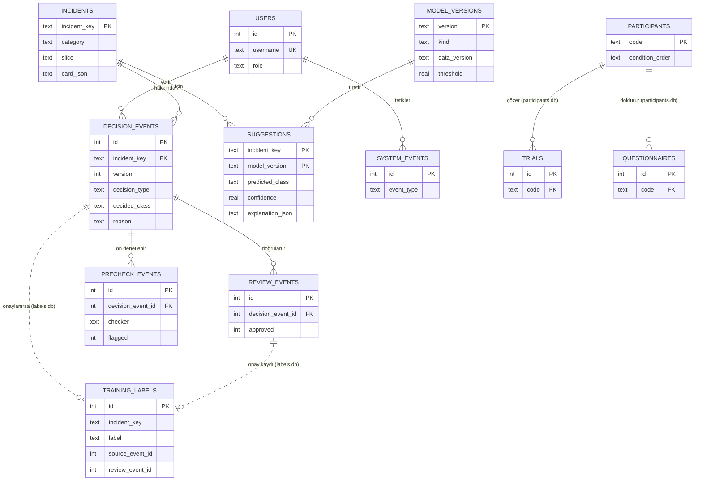

# Veri tasarımı: Açıklanabilir SOC Karar Destek Arayüzü

- **Güncelleme:** 2026-11-02
- **İlgili dokümanlar:** `docs/srs.md`, `docs/architecture.md`, ADR-0002, ADR-0004, ADR-0005, `docs/research/2026-11-02-guide-veri-denetimi.md`

Bu belge yol haritası Adım 2.2 (veritabanı ilişkileri), Adım 2.3 (eğitim/doğrulama/test ayrımı) ve s.10 Adım 2'nin (uyarı, model önerisi, analist kararı, gerekçe ve sürüm için veri şeması; geri bildirim kaydı ile eğitim etiketi deposu ayrı) çıktısıdır.

## 1. Kavramsal model (ER)

Üç ayrı depo var (ADR-0002): **app.db** (denetim izi ve uygulama), **labels.db** (eğitim etiketi deposu), **participants.db** (katılımcı verisi). Kesikli bağlar dosyalar arasıdır ve uygulama düzeyinde denetlenir.



## 2. Mantıksal şema

Tür adları SQLite'a göredir. Zamanlar ISO 8601 UTC metin olarak tutulur. `CHECK` kısıtları sınıf ve rol kümelerini zorlar. "Hafta" sütunu, tablonun hangi hafta oluşturulacağını gösterir.

### 2.1 app.db

| Tablo | Sütun | Tür | Kısıt | Açıklama | Hafta |
|---|---|---|---|---|---|
| users | id | INTEGER | PK | | 5 |
| | username | TEXT | NOT NULL UNIQUE | | |
| | display_name | TEXT | NOT NULL | | |
| | role | TEXT | NOT NULL, CHECK ∈ {analyst, senior, model_owner} | | |
| | password_hash | TEXT | NULL | FR-24 (7–8. hafta); demoda NULL | |
| | created_at | TEXT | NOT NULL | | |
| incidents | incident_key | TEXT | PK | `"<OrgId>-<IncidentId>"` | 5 |
| | org_id, incident_id | INTEGER | NOT NULL, UNIQUE(org_id, incident_id) | | |
| | category | TEXT | NOT NULL, CHECK ∈ 3 kategori | | |
| | slice | TEXT | NOT NULL, CHECK = 'T2' | Arayüze yalnız T2 girer (ADR-0004) | |
| | first_seen | TEXT | NOT NULL | olay zamanı | |
| | n_alerts, n_evidence | INTEGER | NOT NULL, ≥ 1 | | |
| | card_json | TEXT | NOT NULL | Vaka kartı (§9.6); takma adlı | |
| | data_version | TEXT | NOT NULL | | |
| model_versions | version | TEXT | PK | ör. `v1-baseline-<kısa özet>` | 5 |
| | kind | TEXT | NOT NULL, CHECK ∈ {baseline_lr, lgbm} | | |
| | data_version | TEXT | NOT NULL | | |
| | threshold | REAL | NOT NULL, 0 < τ < 1 | FR-04 eşiği | |
| | metrics_json, params_json | TEXT | NOT NULL | doğrulama ölçütleri, ayarlar, tohum | |
| | created_at | TEXT | NOT NULL | | |
| | is_active | INTEGER | NOT NULL, 0/1; kısmi UNIQUE (is_active=1) | Tek etkin sürüm. Etkinleştirme `system_events`'e yazılır | |
| suggestions | incident_key | TEXT | PK₁, FK → incidents | | 5 |
| | model_version | TEXT | PK₂, FK → model_versions | | |
| | predicted_class | TEXT | NOT NULL, CHECK ∈ {TP, BP, FP} | | |
| | confidence | REAL | NOT NULL, [0, 1] | en yüksek sınıf olasılığı | |
| | probs_json | TEXT | NOT NULL | `{"TP":…, "BP":…, "FP":…}` | |
| | needs_review | INTEGER | NOT NULL, 0/1 | confidence < threshold (FR-04) | |
| | explanation_json | TEXT | NOT NULL | §6 `explanation` | |
| **decision_events** (denetim izi) | id | INTEGER | PK AUTOINCREMENT | | 5 |
| | incident_key | TEXT | NOT NULL, FK → incidents | | |
| | version | INTEGER | NULL; kısmi UNIQUE(incident_key, version) WHERE version IS NOT NULL | NULL = tekrar (FR-11) | |
| | is_duplicate | INTEGER | NOT NULL, 0/1; CHECK (is_duplicate=1) = (version IS NULL) | | |
| | decision_type | TEXT | NOT NULL, CHECK ∈ {accept, correct, reject} | | |
| | decided_class | TEXT | CHECK ∈ {TP, BP, FP} ya da NULL; reject ⇔ NULL | | |
| | reason | TEXT | NOT NULL ('' yalnız accept'te), ≤ 2000 | | |
| | suggested_class | TEXT | NOT NULL | karar anındaki önerinin anlık görüntüsü | |
| | suggested_confidence | REAL | NOT NULL | anlık görüntü | |
| | model_version | TEXT | NOT NULL, FK → model_versions | | |
| | data_version | TEXT | NOT NULL | | |
| | actor_user_id | INTEGER | NOT NULL, FK → users | | |
| | actor_role | TEXT | NOT NULL | karar anındaki rol | |
| | opened_at, decided_at | TEXT | NOT NULL; opened_at ≤ decided_at | karar süresi (FR-30) | |
| review_events (denetim izi) | id, decision_event_id, reviewer_user_id, approved, reason, flagged_at_review, created_at | | FK, CHECK | Tekil ya da toplu onay/ret (FR-13). Toplu onayda her kayıt için bir satır yazılır | 9–10 |
| precheck_events (denetim izi) | id, decision_event_id, checker ∈ {rule, llm, rule_fallback}, flagged, reason, created_at | | | FR-16–18 | 9–12 |
| conflict_events (denetim izi) | id, incident_key, opened_by_event_id, resolved_by_user_id, resolved_class, reason, created_at | | | FR-12, FR-14 | 9–10 |
| system_events (denetim izi) | id, ts, event_type ∈ {unauthorized, model_activated, model_trained, precheck_fallback}, actor_user_id NULL, actor_role NULL, detail_json | | | NFR-05, FR-21 | 5 |
| aliases | field, raw_value, alias | TEXT | PK(field, raw_value), UNIQUE(alias) | Tutarlı takma ad (FR-02) | 5 |

**Görünüm `v_effective_decision`:** her olay için `version` değeri en büyük olan `decision_events` satırı. Olay durumu buradan türetilir: satır yoksa KararBekliyor; `decision_type = reject` ise İncelemeGerekli; aksi hâlde KararVerildi. Çelişkili durumu 9–10. haftada `conflict_events`'ten gelir.

**Değişmezlik (NFR-06):** `decision_events`, `review_events`, `precheck_events`, `conflict_events` ve `system_events` tablolarında `BEFORE UPDATE` ve `BEFORE DELETE` tetikleyicileri `RAISE(ABORT, 'audit trail is append-only')` çalıştırır.

### 2.2 labels.db (eğitim etiketi deposu)

| Tablo | Sütun | Tür | Kısıt | Açıklama |
|---|---|---|---|---|
| training_labels | id | INTEGER | PK | |
| | incident_key | TEXT | NOT NULL | |
| | label | TEXT | NOT NULL, CHECK ∈ {TP, BP, FP} | "İnceleme gerekli" (ret) etiket olamaz |
| | source_event_id | INTEGER | NOT NULL, UNIQUE | app.db `decision_events.id` |
| | review_event_id | INTEGER | NOT NULL, UNIQUE | app.db `review_events.id`; onay kaydı |
| | approved_by | TEXT | NOT NULL | kıdemlinin kullanıcı adı |
| | approved_at | TEXT | NOT NULL | |
| | data_version | TEXT | NOT NULL | |

- Bu tablo da yalnız eklenebilir (tetikleyiciler).
- Bir olay için birden çok onaylı etiket varsa eğitimde `approved_at` değeri en yeni olan kullanılır (görünüm `v_current_label`).
- Yazma yolu yalnız `review.approve` ve `review.bulk_approve`'dur. İkisi de app.db'deki onay kaydını yazdıktan sonra labels.db'ye yazar (§5).

### 2.3 participants.db (katılımcı deposu, 15–16. hafta)

| Tablo | Sütunlar | Kısıt |
|---|---|---|
| participants | code PK (ör. `P07`), condition_order (ör. `H-AI-AIX`), group ∈ {student, soc}, created_at | Kimlik bilgisi yok |
| trials | id PK, code FK ON DELETE CASCADE, block, condition ∈ {human, ai, ai_x}, incident_key, decision, duration_ms, ai_suggested_class NULL, ai_correct NULL, is_practice, ts | Alıştırma satırları `is_practice=1`; ölçüme katılmaz (FR-34) |
| questionnaires | id PK, code FK ON DELETE CASCADE, block, instrument ∈ {SUS, NASA_TLX, JIAN, OPEN}, item, value | |

Silme (FR-33): `DELETE FROM participants WHERE code=?`. CASCADE ile ilişkili satırlar da silinir. Bu dosyada değişmezlik tetikleyicisi yoktur.

## 3. Normalizasyon

| Tablo | Fonksiyonel bağımlılıklar | Normal form | Gerekçe ve bilinçli denormalizasyon |
|---|---|---|---|
| users | id → username, display_name, role; username → id | BCNF | — |
| incidents | incident_key → tüm sütunlar; (org_id, incident_id) → incident_key | BCNF | `card_json` tek bir JSON belgesidir. Kart, veri hattının değişmez çıktısıdır ve hiç sorgulanmaz, yalnız gösterilir |
| model_versions | version → tüm sütunlar | BCNF | |
| suggestions | (incident_key, model_version) → tüm sütunlar | 3NF | `needs_review`, `confidence` ve `threshold` değerlerinden türetilir. Eşik sürüm başına sabittir; okuma hızı için saklanır (NFR-01) |
| decision_events | id → tüm sütunlar; (incident_key, version) → id (version NULL değilse) | 3NF | **Bilinçli:** `suggested_class`, `suggested_confidence` ve `actor_role`, karar anının anlık görüntüsüdür. Denetim izi, analistin o an ne gördüğünü kaydetmeli; öneriler yeniden üretilse ya da rol değişse bile kayıt değişmemeli |
| training_labels | id → tüm sütunlar; source_event_id → id; review_event_id → id | BCNF | `approved_by` app.db'deki kullanıcıyı tekrarlar, çünkü dosyalar arası FK yok ve depo kendi başına okunabilmeli |
| participants, trials, questionnaires | anahtar → diğerleri | BCNF | |

## 4. İndeksler

| İndeks | Tablo (sütunlar) | Hizmet ettiği sorgu | Maliyeti |
|---|---|---|---|
| `ux_decision_version` | decision_events(incident_key, version) WHERE version IS NOT NULL | etkin karar, sürüm numarası, geçmiş | Karar başına bir indeks girdisi; çok küçük |
| `ix_decision_incident` | decision_events(incident_key, id) | olay geçmişi (tekrarlar dahil) | aynı |
| `ix_incidents_slice_cat` | incidents(slice, category) | kuyruk | ihmal edilir |
| `ux_model_active` | model_versions(is_active) WHERE is_active=1 | etkin sürüm | — |
| PK | suggestions(incident_key, model_version) | olay ekranı | — |

## 5. İşlemler ve eşzamanlılık

- SQLite WAL kipinde çalışır: okuyucular yazıcıyı beklemez.
- **`record_decision`** tek bir işlemdir:
  1. `BEGIN IMMEDIATE` ile yazma kilidi alınır.
  2. Etkin karar okunur.
  3. Doğrulama kuralları uygulanır.
  4. Sonuç aynıysa `version=NULL, is_duplicate=1` ile, değilse `max(version)+1` ile INSERT yapılır.
  5. `COMMIT`.
  
  Yazıcılar SQLite'ta seri çalıştığı için bu işlem serileştirilebilirdir. Kayıp güncelleme ve aynı sürüm numarasının iki kez verilmesi önlenir. Kısmi UNIQUE indeks ikinci bir güvencedir.
- **Onay (9–10. hafta):** Önce app.db'ye `review_events` yazılır ve commit edilir, sonra labels.db'ye `training_labels` yazılır. İkinci adım başarısız olursa labels.db'de etiket olmaz. Uzlaştırma betiği, onaylı olup etiketi olmayan kayıtları bulup tamamlar. Ters durum, yani onaysız etiket, sıralama gereği oluşamaz.
- **Okumalar:** Tek SELECT'ler; tutarlı anlık görüntü için ayrıca işlem gerekmez.

## 6. Kritik sorgular

```sql
-- Etkin karar (olay ekranı, kuyruk durumu)
SELECT * FROM decision_events
WHERE incident_key = :k AND version = (
  SELECT max(version) FROM decision_events WHERE incident_key = :k);
-- ux_decision_version ile O(log n)

-- Olay ekranı önerisi
SELECT s.* FROM suggestions s
JOIN model_versions m ON m.version = s.model_version AND m.is_active = 1
WHERE s.incident_key = :k;   -- PK araması

-- Geçmiş
SELECT * FROM decision_events WHERE incident_key = :k ORDER BY id DESC;  -- ix_decision_incident
```

Satır sayıları küçük (demo havuzu 300 olay; T2'nin tamamı ~100 bin). Bütün sorgular indeks aramasıdır.

## 7. Hacim, büyüme ve saklama

| Depo | Hacim | Saklama ve silme |
|---|---|---|
| app.db | Demo: 300 olay, en çok birkaç yüz karar. Tam T2 yüklenirse ~100 bin kart (~200 MB) | Denetim izi silinmez, proje sonuna kadar saklanır (K5). Yedek: aşama sonlarında dosya kopyası |
| labels.db | En çok T2 olay sayısı kadar | Silinmez |
| participants.db | 12–18 katılımcı × ~30 deneme | Katılımcı isterse silinir (FR-33). Proje sonunda etik kurul kararına göre |
| İşlenmiş Parquet | Kapsam içi ~510 bin olay × ~60 özellik (float32) ≈ 125 MB | Yeniden üretilebilir; git dışı |
| AS1 simülasyonu | Her koşu bellek içi SQLite kullanır; app.db'ye yazmaz | Sonuç tablosu `artifacts/experiments/` altında |

## 8. Göç stratejisi

- Şema dosyaları `src/socxai/store/schema_*.sql` altında durur. Sürüm `PRAGMA user_version` ile tutulur.
- Her göç numaralı ve ileriye dönüktür. `migrate()` başlangıçta eksik göçleri sırayla uygular.
- Denetim izi tablolarında sütun silinmez. Yeni sütunlar NULL kabul eder ya da varsayılan değer alır.
- Geri alma: göçten önce dosya kopyası alınır, geri dönüş bu kopyadan yapılır.

## 9. Veri kümesi (ML)

### 9.1 Kaynak ve lisans

Microsoft GUIDE, Kaggle Version 2, CDLA-Permissive-2.0, erişim 2026-11-02. Ayrıntı: SRS §7 ve veri denetimi raporu. Ham CSV'ler `data/raw/guide/` altında durur ve değiştirilmez.

### 9.2 Olay tablosu (veri hattı adım 1)

- **Olay anahtarı:** `OrgId-IncidentId`.
- **Olay kategorisi:** Olayın farklı uyarılarının (`AlertId`) `Category` değerlerinin en sık görüleni. Eşitlikte alfabetik olarak ilk olan seçilir. Kapsam içi olaylardan 12.189'u birden fazla kategori içeriyor (2026-11-02 profili).
- **Kapsam:** Kategorisi InitialAccess, SuspiciousActivity ya da Exfiltration olan ve `IncidentGrade` değeri dolu olaylar.
- **Etiket:** `IncidentGrade` → TP (TruePositive), BP (BenignPositive), FP (FalsePositive).
- **Olay zamanı:** `min(CAST(Timestamp AS TIMESTAMP))`.

### 9.3 Bölmeler (ADR-0004)

- Sıralama: (olay zamanı, OrgId, IncidentId).
- Kesimler: T1 %50, T2 %20, doğrulama %15, kilitli test %15.
- Sızıntı denetimleri (AC-26):
  - Dilimlerin olay anahtarı kesişimi boş.
  - Her dilimin en geç olay zamanı bir sonraki dilimin en erken zamanından büyük değil.
  - Yalnız kapsam kategorileri var.
  - Her olayın bütün satırları aynı dilimde.
- Dilim boyutları ve sınıf dağılımı her koşuda `data/processed/<veri_sürümü>/manifest.json` dosyasına yazılır.
- Resmî GUIDE_Test aynı süzgeçle ayrıca işlenir ve yalnız ek sonuç için kullanılır.

### 9.4 Özellikler (ADR-0005)

Hepsi olay düzeyinde toplanır. Sözlükler (en sık değerler) **yalnız T1'den** öğrenilir.

| Grup | Özellik | Kodlama | Sayı |
|---|---|---|---|
| Kategori | `cat=<kategori>` | one-hot | 3 |
| Boyut | `n_alerts`, `n_evidence`, `n_entity_types`, `n_techniques` | log1p | 4 |
| Varlık türü | `entity=<tür>`: T1'deki en sık 15 tür + `entity=other` | log1p(sayı) | 16 |
| Kanıt rolü | `role=Impacted`, `role=Related` | log1p(sayı) | 2 |
| Şüphe | `suspicion=Suspicious`, `suspicion=Incriminated` | log1p(sayı) | 2 |
| Hüküm | `verdict=Suspicious`, `verdict=Malicious`, `verdict=NoThreatsFound` (`DomainPII_*` değerleri yok sayılır) | log1p(sayı) | 3 |
| Varlık rolü (`Roles`) | T1'de en sık 7 değer + `other` | log1p(sayı) | 8 |
| Kaynak türü | `has_resource_type` (herhangi bir `ResourceType` dolu mu) | log1p(sayı) | 1 |
| Tehdit ailesi | `has_threat_family` | log1p(sayı) | 1 |
| MITRE | `mitre=<teknik>`: `;` ile bölünmüş tekil teknikler arasında T1'de en sık 20 teknik | 0/1 | 20 |
| | | **Toplam** | **60** |

- Lojistik regresyon için `StandardScaler` (yalnız T1'den öğrenilir) uygulanır.
- `ActionGrouped`, `ActionGranular` ve bütün sayısal kimlik alanları kullanılmaz (ADR-0005).
- Her özelliğin ham alanı ve olaydaki ham değeri açıklamada gösterilir. Örnek: `entity=MailMessage` → "EntityType = MailMessage, 5 kanıt" (FR-05).

### 9.5 Sınıf dengesi

Kapsam içinde (veri denetimi, olay düzeyi):

| Kategori | TP | BP | FP |
|---|---|---|---|
| InitialAccess | %22,8 | %34,6 | %42,6 |
| SuspiciousActivity | %33,0 | %51,1 | %15,9 |
| Exfiltration | %6,0 | %66,9 | %27,1 |

- Dengeleme yalnız eğitimde, sınıf ağırlığıyla yapılır (`class_weight="balanced"`). Örnek üretme ya da atma yapılmaz.
- Ana ölçüt macro-F1 (deney planı).

### 9.6 Vaka kartı ve takma adlar (FR-02, K2)

**Kart alanları:**
- Kategori, uyarı ve kanıt sayıları.
- MITRE teknik kodları ve adları.
- Varlıklar listesi: takma ad, `EntityType`, `EvidenceRole`, varsa `Roles`, `SuspicionLevel`, `LastVerdict`.
- Uyarılar listesi: uyarı sırası, kategori, ilk zaman. `AlertTitle` gösterilmez.

**Takma ad kuralı:**
- Her varlık türü için birincil kimlik alanı kullanılır:

  | Varlık türü | Kimlik alanı | Takma ad |
  |---|---|---|
  | User | AccountObjectId | Kullanıcı-N |
  | Machine | DeviceId | Cihaz-N |
  | Ip | IpAddress | IP-N |
  | Url | Url | URL-N |
  | File | Sha256 | Dosya-N |
  | MailMessage | NetworkMessageId | Posta-N |
  | Mailbox | AccountUpn | PostaKutusu-N |
  | CloudApplication | ApplicationId | Uygulama-N |
  | Diğer türler | — | `<Tür>-N` (satır bazında) |
- N, demo havuzundaki ilk görülme sırasına göre artar.
- Aynı ham kimlik bütün kartlarda aynı takma adı alır (`aliases` tablosu).
- Bir alanın T1'deki en sık değeri ("yok" anlamına gelen nöbetçi değer olduğu varsayılıyor; veri denetimi) takma ad almaz ve kartta gösterilmez.

**MITRE adları:** Teknik kodundan ada yerel bir eşleme dosyasıyla çevrilir (`data/reference/mitre_techniques.csv`). Dosya yoksa yalnız kod gösterilir.

### 9.7 Sürümleme

- **Veri sürümü:** `sha256(girdi dosyalarının adı, boyutu ve değişiklik zamanı + bölme oranları + kapsam kategorileri + özellik sözlüğü + kod sürümü)` değerinin ilk 12 karakteri.
- Her işlenmiş çıktı `data/processed/<veri_sürümü>/` altında `manifest.json` ile durur.
- Model meta verisi veri sürümünü içerir. Denetim izindeki her karar `data_version` ve `model_version` taşır (FR-09).
